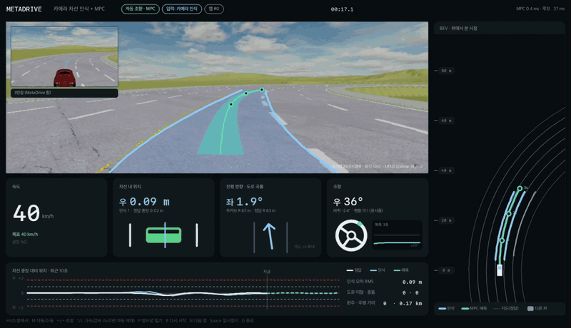
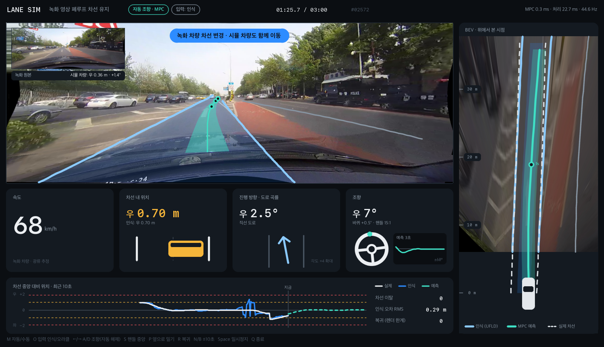

# camera-lane-mpc

Camera-only lane keeping: a single dashcam detects lanes, and a model predictive controller (MPC) steers from what the camera sees.
It runs closed-loop in two environments: a recorded real-world drive, and the MetaDrive simulator.



*Driving in MetaDrive from the dashcam alone. At 0:20 the car is pushed 0.8 m to the right; the MPC plans a 3 s path back (teal) and is centered again within a second. Full 70 s run: [docs/lane_mpc_drive.mp4](docs/lane_mpc_drive.mp4)*

```
dashcam -> UFLD lane detection -> bird's-eye-view fit -> Kalman filter -> lateral MPC -> steering
                                                                      \-> curve-aware cruise -> throttle/brake
```

## Results

**MetaDrive, 5 maps never seen in training.** The controller's only input is the camera; simulator ground truth is used for grading only. The car is shoved 0.8 m sideways every 20 s.

| Lane model | Routes completed | Off-road | Mean lateral error | p95 |
|---|---|---|---|---|
| UFLD, original (trained on CULane) | 0/5 | 5 | 0.37 m | 1.48 m |
| **UFLD, fine-tuned on auto-labeled MetaDrive frames** | **5/5** (3.75 km) | **0** | **0.13 m** | **0.46 m** |
| Reference: MPC fed ground truth (oracle) | 3/3 | 0 | 0.09 m | 0.36 m |

Perception accuracy in curves, measured while driving on ground truth:

| | Offset error mean / p95 | Heading error mean / p95 |
|---|---|---|
| UFLD, original | 0.98 m / 2.72 m | 9.9° / 34.9° |
| UFLD, fine-tuned | 0.16 m / 0.55 m | 2.8° / 10.8° |

**Recorded-drive simulator** (3 min of CULane video, 0.8 m push every 5 s): MPC on UFLD perception keeps a 0.17 m mean lateral error with no lane departures, at 22 ms per frame (30 Hz).

## Two simulators

### 1. A recorded drive turned closed-loop (`sim.py`)

In a recorded video, steering changes nothing on screen. Because the road is a plane, the view from a camera shifted sideways or yawed can be re-rendered exactly with a homography, as NVIDIA did for DAVE-2.
A virtual car follows a kinematic bicycle model. Every frame is re-rendered from its viewpoint, and lanes are detected on that re-rendered image.



- The video has no calibration, so `calibrate.py` estimates it from the road:
  - vanishing point: where the ego lane lines meet
  - camera height: from lane width, assumed 3.75 m
  - speed: optical flow of road features, projected onto the ground
- Focal length is not observable from this footage; it is assumed to be 600 px (override with `--focal`).

### 2. MetaDrive (`md_drive.py`)

The dashcam's intrinsics and mounting are known exactly, so the bird's-eye view is exact.
UFLD trained only on CULane saw the game's sharp curves as straight lines and drove off the road. Ground-truth lane boundaries are therefore projected into the camera to auto-label frames (`md_autolabel.py`), and UFLD is fine-tuned on them (`train_ufld.py`).

## Files

| File | Purpose |
|---|---|
| `ufld.py` | UFLD (Ultra Fast Lane Detection) ONNX inference (5 ms with CoreML) and a lane tracker |
| `bev.py` | Flat-ground camera model: image <-> ground, BEV, virtual-viewpoint re-rendering, lane offset / heading / curvature |
| `controller.py` | Kalman filter and lateral MPC (kinematic bicycle model, OSQP, curvature preview) |
| `hud_kit.py` | HUD drawing kit (cached Korean-capable text, panels, translucent shapes) |
| `lane_detect.py`, `play_lanes.py` | Classical lane detection (Canny + Hough) and 30 Hz playback |
| `calibrate.py`, `sim.py` | Calibration of the recorded drive; the closed-loop simulator and its HUD |
| `md_mac.py` | Patches that make MetaDrive 0.4.3 render on Apple Silicon (MSAA, OpenGL 3.2, GLSL) |
| `md_play.py` | Drive MetaDrive with the keyboard |
| `md_drive.py` | Camera-based autopilot in MetaDrive, with HUD, evaluation and recording |
| `md_autolabel.py`, `train_ufld.py`, `md_eval_perception.py` | Auto-labeling, UFLD fine-tuning, perception evaluation |

## Setup

Tested on macOS (Apple Silicon) with Python 3.9. The HUD uses macOS system fonts, and its labels are in Korean.

```bash
# Recorded-drive pipeline
python3 -m venv .venv && .venv/bin/pip install -r requirements.txt

# MetaDrive pipeline (see the note at the top of requirements-metadrive.txt)
python3 -m venv .venv-md
.venv-md/bin/pip install metadrive-simulator==0.4.3
.venv-md/bin/pip uninstall -y opencv-python
.venv-md/bin/pip install -r requirements-metadrive.txt

# Model weights (original + fine-tuned)
bash scripts/download_models.sh
```

## Run

```bash
# MetaDrive, camera-based autopilot (in the HUD window: M auto/manual, <-/-> steer, P push, N next map)
.venv-md/bin/python md_drive.py
.venv-md/bin/python md_drive.py --episodes 5 --fast --no-hud --push-every 200   # evaluate
.venv-md/bin/python md_drive.py --model models/culane_18.onnx                   # compare with the original model
.venv-md/bin/python md_drive.py --oracle                                       # compare with ground-truth input
.venv-md/bin/python md_drive.py --episodes 1 --fast --no-hud --record drive.mp4

# Reproduce the fine-tuning (on an M4: ~7 min to auto-label 4,000 frames, ~16 min for 6 epochs)
.venv-md/bin/python md_autolabel.py --frames 4000 --out data/md_lanes
.venv-md/bin/python train_ufld.py --data data/md_lanes --epochs 6 --out models/culane_18_md.onnx

# Recorded drive (needs the CULane frame folder; see "Data and models")
.venv/bin/python calibrate.py
.venv/bin/python sim.py --start 2400
```

## Limitations

- **Road types:** fine-tuning used 4,000 frames from 10 maps with straights and curves only. Intersections, roundabouts and ramps are not handled yet.
- **No lead-vehicle following:** there is no adaptive cruise control yet, so evaluation ran without traffic.
- **Real-world performance of the fine-tuned model is untested.** `sim.py` keeps the original model.
- **Vehicle model:** the MPC uses a kinematic bicycle model, with no tire slip or steering-actuator lag.

## Data and models

- **UFLD:** Qin et al., *Ultra Fast Structure-aware Deep Lane Detection*, ECCV 2020. [cfzd/Ultra-Fast-Lane-Detection](https://github.com/cfzd/Ultra-Fast-Lane-Detection) (MIT). ONNX export from [ailia-models](https://github.com/axinc-ai/ailia-models).
- **CULane:** the [CULane dataset](https://xingangpan.github.io/projects/CULane.html) is licensed for non-commercial use and is not included here.
- **MetaDrive:** [metadriverse/metadrive](https://github.com/metadriverse/metadrive) (Apache 2.0).
